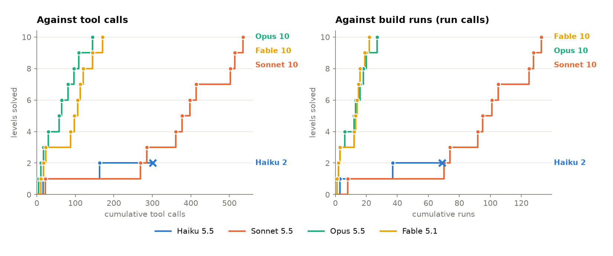

# Levels 1-10: Claude models compared

Four Claude models played Fantastic Contraption's first ten official levels
in order, through Claude Code (`python3 -m fcenv.cc`). Each was run once.

| Level | Haiku 5.5 | Sonnet 5.5 | Opus 5.5 | Fable 5.1 |
|---|---:|---:|---:|---:|
| 01-rolling-away | 16 / 3 | 22 / 8 | 5 / 1 | 11 / 1 |
| 02-reach-up | 147 / 34 | 247 / 62 | 6 / 1 | 6 / 1 |
| 03-mind-the-gap | 138 / 32 ✗ | 17 / 4 | 6 / 1 | 6 / 1 |
| 04-junkyard | – | 75 / 18 | 13 / 3 | 65 / 9 |
| 05-the-wall | – | 16 / 3 | 28 / 6 | 9 / 1 |
| 06-on-a-roll | – | 20 / 6 | 7 / 1 | 9 / 1 |
| 07-full-up | – | 17 / 4 | 16 / 3 | 7 / 1 |
| 08-higher | – | 89 / 20 | 15 / 2 | 8 / 1 |
| 09-around-the-bend | – | 11 / 3 | 13 / 2 | 24 / 3 |
| 10-up-the-hump | – | 21 / 5 | 36 / 7 | 26 / 3 |
| **Total** | 301 / 69 | 535 / 133 | 145 / 27 | 171 / 22 |
| **Levels solved** | 2 | 10 | 10 | 10 |
| **Output tokens** | 269K | 196K | 69K | 517K |
| **Input tokens (incl. cache)** | 23.9M | 15.2M | 2.4M | 10.9M |

Cells are tool calls / build runs (`run` calls) per level; ✗ marks the
level a series stopped at, unsolved.

## Setup

- Models: `claude-haiku-5-5`, `claude-sonnet-5-5`, `claude-opus-5-5` and
  `claude-fable-5-1`, each at its default effort, through Claude Code on a
  subscription. The agent gets only this project's tools (over MCP), an
  empty system prompt and no built-in tools.
- **Gated**: a level counts as solved only once the agent has seen its
  design beat it (`submit` accepts only a design that does, or the agent's
  own last run of its final design solved), and the next level is played
  only after that. There's no stopping early: a reply without a tool call
  gets a nudge to carry on, and ten such replies in a row end the level
  (as in Inspect's ReAct agent).
- **Notes**: a notebook (up to 15,000 characters) carries over from level
  to level; it's the only memory between levels, and the agent can update
  it after each solved level. Each model's final notebook is in its folder.
- **Effort**: the only limit is a hidden cap of 1,000 tool calls for the
  whole series. No budget or time limit per level; when the plan's 5-hour
  usage window filled, the run waited for it to reset and resumed.
- Tool calls exclude `write_notes`, which is free.

## Observations

- **Opus 5.5** solved all ten in 145 tool calls and 27 runs, four levels
  with a single run each, and never needed a nudge. It used the fewest
  tokens by far.
- **Fable 5.1** solved all ten in 171 calls and the fewest runs (22): seven
  levels took a single run. It thinks much more per call (7.5x Opus's
  output tokens), and one level (Junkyard) took 57% of a 5-hour usage
  window on its own.
- **Sonnet 5.5** solved all ten in 535 calls. Almost half of them went on
  level 2 (247); the other nine took 288.
- **Haiku 5.5** solved two levels and stopped at level 3 after 138 calls
  there. It stopped deliberately: its last replies each said it wouldn't go
  on, as its best launch reached about half the speed it had worked out the
  ball needed. An earlier run with a 600-call cap ended the same way.

With one run per model, one bad level moves a whole curve (Sonnet's level
2; Fable's level 4), so read the gaps between the top three as rough.

## Caveats

- Opus's series ran with a 600-call cap and a 240-minute wall clock per
  level; neither came into play (145 calls in all, no level over 4 minutes).
- Sonnet's series was played in three segments, each starting from the
  previous one's notebook: levels 1-3 and 4-9 under a 600-call cap (the
  first attempt at level 4 was cut off by a usage limit, before
  pause-and-resume existed, and replayed), and level 10 again from its
  starting notebook after the cap was raised to 1,000 (the first attempt
  ran out of calls at 86). The prompt numbers levels within a segment.
- Levels are played in a reimplementation of the game's physics (`core/`),
  which agrees with the original Flash game on 97.8% of tracked designs.

Each model's folder has its `summary.json` (every level's result: stop
reason, counts, token usage, plan usage, timings) and final `notes.md`.
`compare.json` has the numbers behind the chart, made with
`python3 -m fcenv.compare`.
